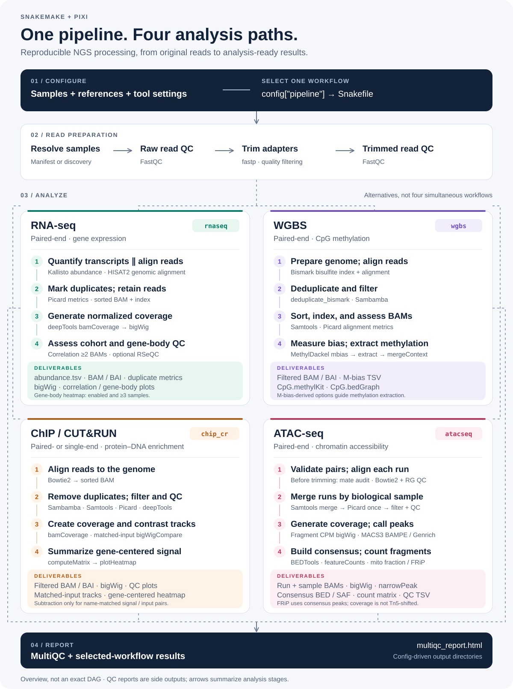

# Modular NGS Pipeline


Snakemake + Pixi pipeline for five NGS workflows: RNA-seq, WGBS, ChIP-seq/CUT&RUN, ATAC-seq, and configurable 16S amplicons. A single value in `config/config.yaml` selects which workflow is imported and run.

## Workflow Overview



The overview above shows the four genome/transcriptome workflows. The fifth branch,
[`amplicon`](docs/amplicon.md), supports SE/PE 16S reads with configurable primers,
DADA2 denoising, optional reference-based taxonomy, and ASV/read-retention outputs.

## Repository Map
- `Snakefile`: top-level entrypoint; dispatches to the selected workflow.
- `config/config.yaml`: main configuration and sample/reference paths.
- `workflows/*.smk`: top-level workflow modules for `rnaseq`, `wgbs`, `chip_cr`, `atacseq`, and `amplicon`.
- `workflows/rules/**/*.smk`: reusable and pipeline-specific Snakemake rules.
- `src/utils.py`: sample discovery and config helper functions.
- `backlog.md`: notable implemented changes and planned work.

## Requirements
- Linux.
- [Pixi](https://pixi.sh/) installed.
- Disk space for FASTQ, BAM, reference indexes, and results.
- Optional Graphviz `dot` to render DAG images.

## Setup
```bash
git clone <repo-url>
cd snakemake-hydra
pixi install --locked
```

`pixi.toml` defines dependencies but no tasks. Use `pixi run --locked ...` to
reject a stale lockfile; Hydra enforces this for its nested Pixi commands too.
When changing `pixi.lock`, start a new results directory or rebuild all old
outputs before combining them with results from the new environment.

## Configure
Edit `config/config.yaml` before running.

```yaml
pipeline: "wgbs"  # rnaseq, wgbs, chip_cr, atacseq, or amplicon
```

At minimum, configure the selected pipeline block:
- `raw_fastqs_dir` and/or `samples_info`.
- Reference FASTA/BED/index paths required by that pipeline.
- Output directories if the defaults are not suitable.
- `<pipeline>.multiqc_results_dir` for the MultiQC report location (amplicons use `<amplicon.output_dir>/multiqc`).

The checked-in config contains safe placeholder paths. Replace them for your environment, but avoid changing unrelated pipeline blocks unless you intend to switch or update them.

Machine-specific paths and real sample manifests can be kept in `config/config.local.yaml`, which is ignored by Git and selected automatically when present. Set `HYDRA_CONFIG=/path/to/another.yaml` to select another complete config without recursively merging placeholder samples. Verify local files with `git check-ignore -v config/config.local.yaml` before sharing changes.

Reference inputs are user-managed. The pipeline does not download genomes or annotations. Config values are checked for presence during workflow setup; missing files, permissions, or unwritable index directories fail later during Snakemake input resolution or tool execution.

## Samples
Manual sample declarations live under the selected pipeline's `samples_info`:

```yaml
chip_cr:
  raw_fastqs_dir: "data/chip_fastqs"
  samples_info:
    liver_rep1:
      R1: "data/chip_fastqs/liver_rep1_R1.fastq.gz"
      R2: "data/chip_fastqs/liver_rep1_R2.fastq.gz"
      type: "PE"
```

If `samples_info` is missing or empty, `src/utils.py` discovers FASTQs in `raw_fastqs_dir` using these patterns:
- Paired-end: `_R1/_R2`, `_1/_2`, `.R1/.R2`.
- Single-end: `<sample>.fastq.gz` or `<sample>.fq.gz`. A bare trailing digit is
  part of the sample name (`sample1.fastq.gz`), so numeric mates require a
  separator (`sample_1.fastq.gz`, `sample.1.fastq.gz`, or `sample-1.fastq.gz`).

Sample support differs by pipeline:
- `rnaseq` and `wgbs` require paired-end samples with `R1` and `R2`.
- `atacseq` accepts a run-aware `samples_info.<sample>.runs.<run>` mapping. Each run contains its original `R1`, `R2`, provenance fields, and read-group assignment.
- `chip_cr` accepts paired-end and single-end samples; `type` is inferred from `R2` when omitted.
- `amplicon` accepts SE/PE manifests or a TSV, plus strict FASTQ discovery. Explicit primer handling and a comparable region/mode per cohort are required; see [amplicon configuration](docs/amplicon.md).
- ChIP/CUT&RUN subtraction pairs signal `<base>_repN` with input `<base>_input_repN`; `<base>` may contain underscores.

## Run Commands
Dry-run the selected pipeline:

```bash
pixi run --locked snakemake -n --cores 1
```

Run the selected pipeline:

```bash
pixi run --locked snakemake --cores 8 --printshellcmds --latency-wait 60
```

Re-run incomplete jobs:

```bash
pixi run --locked snakemake --cores 8 --rerun-incomplete
```

Dry-run one imported rule path:

```bash
pixi run --locked snakemake -n --cores 1 --until <prefixed_rule_name>
```

Dry-run one concrete output:

```bash
pixi run --locked snakemake -n --cores 1 <path/to/output>
```

Generate a DAG:

```bash
pixi run --locked snakemake --dag --cores 1
pixi run --locked snakemake --dag --cores 1 | dot -Tpng > dag.png
```

Focused rules must belong to the current `pipeline` value because `Snakefile` imports only the selected workflow. Imported rule names are prefixed, for example `rnaseq_hisat2_align_pe`, `wgbs_bismark_alignment`, `chip_cr_fastqc_raw_pe`, or `atacseq_bowtie2_align_pe`.

Useful concrete dry-run targets:
- RNA-seq: `results/rnaseq/kallisto/sample/abundance.tsv`.
- WGBS: `results/wgbs/methyldackel/sample_CpG.methylKit`.
- ATAC-seq: `results/atacseq/peaks/sample_peaks.narrowPeak`.
- ATAC-seq quantification: `results/atacseq/featurecounts/consensus_peak_counts.txt`.
- MultiQC: `<multiqc_results_dir>/multiqc_report.html`.

## Validation
Small real-data fixtures for RNA-seq, WGBS, ChIP-seq/CUT&RUN, and both ATAC-seq
peak callers are documented in [test_data/README.md](test_data/README.md).
The preparer retains seeded random subsets, removes temporary source FASTQs,
and generates separate configs without editing production paths.

GitHub Actions always runs lightweight checks for patch whitespace, Python syntax,
and CI selection. On pull requests, it runs only the pipeline fixtures affected by the
full PR diff. Changes to shared files select all their registered consumers;
changes to global or unrecognized files select the full suite. Documentation-only
PRs run the lightweight checks without installing Pixi. Pushes to `main` and manual
runs still execute the full suite. See the CI selection summary for the reasons a
pipeline was selected. If configuring branch protection, require the `CI gate`
check rather than individual fixture jobs, which may be intentionally skipped.

Selected fixtures use the committed Pixi lockfile. The bundled 16S smoke suite
covers PE/SE, archive headers, primers, taxonomy, sequencing batches, expected
overlap failure, repeatability, and output reconstruction. A manual **Run workflow**
invocation can also enable the public ENA V4 test with RDP 19 taxonomy.
Validation logs and reports are retained as CI artifacts for seven days (90 days
when started with **Run workflow**). For a release, run the complete suite on the
release commit and copy the current-run evidence into the release assets or a
durable archive before CI artifacts expire. Retain the commit and lockfile,
fixture provenance and expected hashes, generated configs, verifier results,
and the exact replay commands. Archive inputs only where redistribution is
permitted. Historical evidence checked into `test_data/` is not a substitute for
a current release run.

A separate real-data matrix executes RNA-seq, WGBS chromosome 5 and full TAIR10,
ChIP-seq PE/SE, CUT&RUN, and ATAC-seq with MACS3 and Genrich. Each job downloads
only its selected assay/reference, checks the DAG, executes the complete workflow,
and verifies mapped BAMs, assay outputs and MultiQC. ChIP SE and ATAC Genrich use
one core, as does chromosome-5 WGBS; other variants use two cores, with one scheduled job at a time. At most
two matrix jobs run concurrently. Source checksums and execution evidence are
stored in the diagnostic artifacts, alongside logs and reports. Raw FASTQs, BAMs,
indexes and bigWigs are excluded from uploads. These small fixtures check software
behavior; they do not validate biological accuracy.

The ATAC MACS3 fixture splits each sample into two disjoint run fixtures and
verifies merged read-group metadata and record counts. Genrich keeps the legacy
single-run input path. Whitespace checks cover the complete PR or pushed commit
range, including multi-commit pushes. The [CI pipeline registry](.github/ci/pipelines.json)
records fixture variants and shared file dependencies. When adding a pipeline,
register its fixture jobs and any shared dependencies there. To preview selection
locally for committed changes, run
`python3 .github/ci/plan.py --event pull_request --base origin/main`.

CI also checks ambiguous FASTQ discovery and ATAC quantification with empty peak
sets or insufficient consensus support. An empty consensus produces a zero-row
count matrix; no fragments are processed by featureCounts and FRiP is `NA`.

There is no configured formatter, typechecker, or general unit-test framework.
Use focused Snakemake dry-runs while developing changes:
- Snakemake parses every section of `config/config.yaml`, including inactive pipelines, so the complete YAML document must remain valid.
- Sambamba filter expressions for the selected pipeline are parsed by Sambamba during workflow construction, before any jobs run.
- Config-only changes: run `pixi run --locked snakemake -n --cores 1` for the selected pipeline.
- Rule changes: dry-run through the affected prefixed rule with `--until`.
- Filename/path changes: dry-run a concrete output target.
- MultiQC dependency changes: dry-run the final `multiqc_report.html` path.

## Replaying and comparing runs

For a replay, use the same commit and lockfile, configure an explicit ordered
sample/run manifest, and run into a new output directory. Fixture configs
include `replay_evidence.roles`: an ordered list of `{role, path}` entries for
the config, reads, and references. For production, add that list explicitly to
an audit YAML or the workflow config; the recorder does not rediscover files.
Include annotations, external indexes and their manifests, and any taxonomy
training set used by the selected assay. A dirty tracked tree is recorded but
not reconstructible from its commit alone; keep the patch or use a clean checkout.

Capture the input identity before and after processing with the same command
and a different `--output` each time, then compare both documents:

```bash
pixi run --locked python scripts/replay_evidence.py record --stage pre \
  --config test_data/configs/rnaseq.yaml --output test_data/work/before.json \
  --invocation '<exact run command>'
pixi run --locked python scripts/replay_evidence.py compare \
  --baseline test_data/work/before.json --current test_data/work/after.json
```

For outputs, compare selected scientific files from both runs with `compare`,
or create two ordered role lists with the same role names and capture them with
`record --stage post`. Comparisons are exact after normalization: BAM/SAM
content is decoded and records are sorted for comparison, ignoring `@PG`
metadata; tables preserve row order and JSON keys are sorted. Compare scientific
artifacts rather than whole directories containing path- and time-dependent
metadata. CI replays paired 16S and compares ASV counts, sequences, read tracking,
and taxonomy. It also replays RNA-seq alignment and quantification in a new
results tree and compares decoded alignments and abundance tables. WGBS,
ChIP/CUT&RUN, and ATAC check input identity and output contracts but do not yet
run a second clean analysis automatically.

## Pipeline Notes

### Amplicons (16S)

See [the amplicon guide](docs/amplicon.md) for read-layout detection, primers, per-sample filtering, sequencing batches, optional taxonomy, and the executable smoke checks. Select `pipeline: amplicon`; existing configurations for other pipelines do not need an amplicon section.

The [test-data instructions](test_data/README.md#configurable-16s-amplicons)
include a reproducible public ENA V4 fixture with random paired subsampling,
verified checksums, documented primers, and RDP 19 taxonomy.

### RNA-seq
- Gene body coverage defaults to disabled when its configuration is omitted.
- Requires paired-end samples.
- Required config values include `transcriptome_fasta`, `kallisto_index`, `ref_genome`, and `hisat2_index_dir`.
- The pipeline can build the Kallisto index and HISAT2 indexes at the configured paths.
- Gene body coverage is controlled by `rnaseq.gene_body_coverage.enabled`; `refgene_bed` is required only when enabled.
- Gene body coverage heatmap output is tracked only when at least 3 samples are analyzed.
- The deepTools correlation heatmap is generated only when at least 2 aligned BAMs are available.
- Every R1/R2 pair is audited by the shared FASTQ validator before trimming.
  `rnaseq.fastq_validation` controls whether all records are checked; reports are
  written to `fastq_pair_validation_dir`.
- HISAT2 emits deterministic `@RG` metadata (`ID`, `SM`, `LB`, `PL`, `PU`) from
  `samples_info.<sample>.read_group`; aligned BAMs are validated into
  `read_group_qc_dir` before Picard duplicate marking.

### WGBS
- Requires paired-end samples.
- `ref_genome` must point to the source FASTA. Hydra copies it into the dedicated `reference_dir` (default `results/wgbs/reference`) and tracks the generated Bismark index components and FASTA index there. Keep that directory separate from the source FASTA and use a different staging directory for each reference. Set `bismark.large_index: true` when the reference requires Bowtie2’s large `.bt2l` index format.
- `wgbs.log_dir` overrides the default `logs/wgbs` location.
- `wgbs.sambamba.extra_args` is a Sambamba filter expression, not a generic command-line argument string.
- Bismark Bowtie2 threads are derived from `wgbs.bismark.threads / wgbs.bismark.parallel`; keep `threads >= parallel`.
- MethylDackel outputs include `<sample>_CpG.methylKit` and merged-context `<sample>_CpG.bedGraph`.
- R1/R2 pairs are audited before trimming. Bismark output is annotated with
  deterministic `@RG` metadata through `samtools addreplacerg`, then validated
  into `read_group_qc_dir` before deduplication.

### ChIP-seq/CUT&RUN

Single-end QC and trimming select sample names explicitly from `samples_info`.
Duplicate marking writes a temporary BAM; filtering pipes into Sambamba sorting
with a shared thread budget. One-core filtering jobs run the tools sequentially.

- Supports paired-end and single-end samples.
- PE pairs are checked for synchronized mates and SE files use the shared FASTQ
  reader/audit before trimming. Bowtie2 emits deterministic `@RG` metadata and
  each aligned BAM is validated into `read_group_qc_dir` before duplicate marking.
- Requires `ref_genome`, `gene_bed`, and `bowtie2_index_dir` config values.
- Bowtie2 indexes are created in `bowtie2_index_dir` when needed.
- `chip_cr.sambamba.view_extra_args` is validated as a Sambamba filter expression before execution.
- `plotFingerprint` and correlation include input controls; heatmap `computeMatrix`/`plotHeatmap` excludes `_input` samples.
- Subtracted bigWigs are produced only for samples with matching `<base>_repN` and `<base>_input_repN` names.

### ATAC-seq

Bowtie2 adds per-run read groups, validates them, and merges runs before Picard. Alignment and filtering
share the effective job thread budget with their sorting processes. Filtering
pipes into Sambamba sort; one-core jobs use temporary files to run sequentially.

- Requires paired-end samples.
- Requires `ref_genome` and either a writable `bowtie2_index_dir` or a complete prebuilt `bowtie2_index_prefix`.
- `bowtie2_index_prefix` is the shared prefix passed to Bowtie2 `-x`, without `.1.bt2`, `.rev.1.bt2`, or another index suffix. A configured prebuilt prefix takes precedence over `bowtie2_index_dir` and requires `<prefix>.manifest.json`. Use `pixi run --locked python src/atac_bowtie2_manifest.py create --prefix <prefix> --reference <source.fa> --builder-version <version>` only for an index with known build provenance. Hydra checks the source FASTA and all six component hashes, plus the contig dictionary. A manifest cannot prove the history of an index whose origin is unknown; rebuild such indexes.
- Prebuilt indexes may use either the six `.bt2` files or the six `.bt2l` files. Partial, mixed, or simultaneously complete families are rejected before the ATAC DAG runs.
- Without a prebuilt prefix, Hydra builds and tracks all six index files in `bowtie2_index_dir`; set `bowtie2.large_index: true` to generate `.bt2l` instead of `.bt2` files.
- The index is checked once with `bowtie2-inspect`, and a prefix-specific marker is written under `reference_dir`; prebuilt index directories are never created or modified.
- `peak_caller` must be `macs3` or `genrich`.
- Both peak-caller paths expose the shared `peaks/<sample>_peaks.narrowPeak` output; Genrich uses an intermediate queryname-sorted BAM.
- Every configured R1/R2 pair is validated before trimming by normalized cluster ID, mate label, FASTQ structure, provenance, and record count. `fastq_validation.all_records: true` performs the default complete audit; setting it to `false` reports only a sampled validation of the first `fastq_validation.records` pairs.
- `samples_info.<sample>.runs.<run>.read_group` accepts `id`, `sample`, `library`, `platform`, and `platform_unit`. Use one unique `id` per run or lane, keep `sample` stable for the biological sample, and reuse `library` only for runs from the same physical library preparation.
- Each run is trimmed and aligned independently. Hydra validates every run BAM's complete RG header/tag assignment, retains run-level BAM and samtools QC files, and coordinate-merges runs by biological sample with `samtools merge`.
- Picard MarkDuplicates runs exactly once on each merged biological-sample BAM. It can therefore detect recurring PCR duplicates across runs that share an `LB`; duplicate-flagged reads are removed later with Sambamba before downstream QC, bigWig generation, and peak calling.
- Keep physical-run metadata (`provider_id`, instrument run, flowcell, lane, barcode, R1, R2, and RG values) in the manifest. Use `null` for an unavailable barcode rather than inferring it from a filename or sample label, and report the missing barcode as residual provenance uncertainty.
- The deepTools correlation heatmap is generated only when at least 2 filtered BAMs are available.
- MACS3 uses true paired-fragment `BAMPE` mode. Tn5 insertion-site shifting is intentionally left to downstream analysis.
- Per-sample narrowPeak files are converted to sorted BED3 intervals before consensus construction. `consensus_peaks.minimum_support` controls how many samples must overlap a region and defaults to `1`.
- featureCounts quantifies paired-end fragments from all filtered BAMs over the consensus peak SAF. `featurecounts.threads`, `featurecounts.minimum_mapping_quality`, and `featurecounts.extra_args` control this step.
- featureCounts uses a unique scratch directory, removed after the job, to avoid its temporary-file path overflow with long output directories.
- The default featureCounts MAPQ threshold is `0` because mapping-quality filtering is already configurable in `sambamba.view_extra_args`.
- `mitochondrial_contigs` lists contig names used to calculate the pre-filter mitochondrial fraction from aligned BAMs.
- Core ATAC QC is written both as a standalone TSV and as a custom table in MultiQC. It includes aligned/final reads, Picard duplicate metrics, mitochondrial fraction, fragments in peaks, and FRiP.
- FRiP uses the cohort-wide consensus peak set, so its value can change when samples or `consensus_peaks.minimum_support` change.
- BigWigs contain full-fragment CPM read coverage and are not Tn5-shifted insertion-site tracks.
- Bowtie2, Picard, and Sambamba behavior remains config-driven. `picard.java_opts` and `picard.markduplicates.extra_args` control duplicate marking; duplicate removal remains downstream during filtering. `sambamba.view_extra_args` is validated as a Sambamba filter expression before execution. Choose stricter ATAC-specific alignment or filtering arguments in `bowtie2.extra_args` and `sambamba.view_extra_args` when appropriate for the dataset.
- Bowtie2 alignments depend directly on all six real index files and the pipeline-owned validation marker.

## Outputs
Output paths are config-driven. Common defaults and examples include:
- MultiQC report: `<pipeline>.multiqc_results_dir/multiqc_report.html`.
- RNA-seq Kallisto: `results/rnaseq/kallisto/<sample>/abundance.tsv`.
- RNA-seq aligned BAM: `results/rnaseq/aligned_bams/<sample>_pe.sorted.bam`.
- Shared FASTQ audit: `<pipeline>.fastq_pair_validation_dir/<sample>.fastq_pair_validation.tsv`.
- Shared BAM read-group audit: `<pipeline>.read_group_qc_dir/<sample>_pe.read_group_validation.tsv` (or `_se` for ChIP SE).
- WGBS MethylDackel: `results/wgbs/methyldackel/<sample>_CpG.methylKit`.
- ChIP/CUT&RUN bigWig: `results/chipseq_cutrun/bigwigs/<sample>_pe.bw` or `<sample>_se.bw`.
- ATAC-seq peaks: `results/atacseq/peaks/<sample>_peaks.narrowPeak`.
- ATAC-seq run BAM: `results/atacseq/aligned_bams/runs/<sample>__<run>.sorted.bam`.
- ATAC-seq merged BAM: `results/atacseq/aligned_bams/<sample>_pe.sorted.bam`.
- ATAC-seq Bowtie2 validation: `results/atacseq/reference/bowtie2_index_<hash>.validated.OK`.
- ATAC-seq consensus peaks: `results/atacseq/consensus_peaks/consensus_peaks.bed` and `.saf`.
- ATAC-seq featureCounts matrix: `results/atacseq/featurecounts/consensus_peak_counts.txt`.
- ATAC-seq QC summary: `results/atacseq/qc_summary/sample_qc_summary.tsv`.

## Troubleshooting
- No samples found: check that `samples_info` is populated or `raw_fastqs_dir` exists with supported FASTQ names.
- Rule not found in a focused run: check `config["pipeline"]`; only the selected workflow's prefixed rules are imported.
- RNA-seq/WGBS/ATAC reject a sample: these workflows require paired-end `R1` and `R2` inputs.
- Missing correlation heatmap: the workflow skips correlation when fewer than 2 BAMs are available.
- Missing RNA-seq gene body coverage heatmap: it is emitted only with at least 3 samples and when gene body coverage is enabled.
- Missing ChIP/CUT&RUN subtraction: verify names follow `<base>_repN` and `<base>_input_repN`.
- Empty ATAC consensus peaks: lower `consensus_peaks.minimum_support` or inspect the per-sample narrowPeak files.
- Invalid prebuilt ATAC index: configure the prefix without a suffix and verify that exactly one complete six-file `.bt2` or `.bt2l` family exists.
- Reference or index failure: configured references must exist and generated index directories must be writable; prebuilt indexes only need to be complete and readable.

## License
See `LICENSE`.
