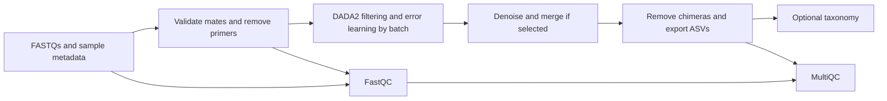

# Configurable 16S amplicons

Select `pipeline: amplicon` in a complete Hydra config. This branch uses Cutadapt
and DADA2, rather than the fastp trimming defaults used by other branches.
It accepts short-read single-end or paired-end FASTQs, compressed or uncompressed.
Primers, read lengths, the amplified region, and the taxonomy database are not
hardcoded. This first implementation targets 16S; ITS, long-read denoising,
diversity analysis, and differential abundance are not validated here.



## Configure inputs

Copy the complete `config/config.yaml` to an ignored local config or a path outside
the checkout, then edit its `amplicon` section. The four original module mappings
remain required by Hydra; an older config without `amplicon` still works for the
original pipelines. All input paths, including paths in a TSV, are interpreted
relative to the repository working directory unless absolute.

Choose one input method:

- `samples_info`: a YAML mapping from sample IDs to `R1` and optional `R2` paths.
- `sample_sheet`: a TSV with `sample`, `R1`, and optional `R2`, `mode`, `batch` columns.
- `raw_fastqs_dir`: discovery in the immediate directory when neither manifest is
  supplied. Supports `_R1/_R2`, `_1/_2`, `.R1/.R2`, optional `_001`, and single-end
  `.fastq`/`.fq` with optional `.gz`. Duplicate mate matches and orphan R2 files
  fail rather than silently selecting a file. Use a manifest for unusual names.

Example YAML manifest (the primer values are examples, not defaults):

```yaml
pipeline: amplicon
# Keep the original rnaseq, wgbs, chip_cr, and atacseq mappings here too.
amplicon:
  output_dir: results/amplicon
  log_dir: logs/amplicon
  threads: 4
  mode: auto
  samples_info:
    sample_A:
      R1: data/sample_A_R1.fastq.gz
      R2: data/sample_A_R2.fastq.gz
      batch: sequencing_run_1
    sample_B:
      R1: data/sample_B_R1.fastq.gz
      R2: data/sample_B_R2.fastq.gz
      batch: sequencing_run_1
      filter:
        trunc_len: [240, 200]
  primers:
    mode: remove
    forward: CCTACGGGNGGCWGCAG
    reverse: GACTACHVGGGTATCTAATCC
    error_rate: 0.1
    min_overlap: 10
  dada2:
    trunc_len: [0, 0]
    trim_left: [0, 0]
    max_ee: [2, 2]
    min_len: 50
  taxonomy:
    enabled: false
```

The runnable defaults and full parameter list are in `config/config.yaml`; the
snippet above omits the other four sections. `batch` separates error learning by
sequencing run and read direction; it is not a biological treatment group.
Missing batch values use `default`. Denoising pooling stays within each
batch/read; chimera removal considers the resulting cohort table.

## Primer handling and quality choices

Explicitly set `primers.mode`:

- `remove`: provide full IUPAC primer sequences in each read's **sequenced
  orientation**. Require an anchored 5' match and discard untrimmed reads. For
  paired data, both mates must match. Also remove optional 3' read-through of the
  opposite primer's reverse complement. `min_overlap` controls optional 3'
  matching and must not exceed the primer lengths; 5' anchored matches require the
  full primer. SE needs the forward primer, with an optional reverse primer to
  handle 3' read-through. Primers are not inferred or reverse-complemented at 5'.
- `already_removed`: retain the inputs without primer trimming, while still
  validating structure, count, read lengths, and mate synchronization.

YAML samples can override `primers` and `filter` settings. Filter overrides accept
`trunc_len`, `trim_left`, `max_ee`, `min_len`, and `trunc_q`. Length and error vectors
always mean `[R1, R2]`, even in R2-only mode. Fixed truncation defaults to zero;
this avoids assuming a particular read length but does not promise suitability
for every dataset. DADA2 removes ambiguous bases and PhiX.

Inspect FastQC and `primers/<sample>.reads.json` before choosing truncation.
The JSON records full-read length distributions and input/primer-retained counts.
To prepare reads and inspect QC without denoising:

```bash
HYDRA_CONFIG=/path/to/config.yaml pixi run snakemake --cores 4 --until amplicon_fastqc
```

`mode: auto` detects layout: paired inputs use `merge`, single-end inputs use
`forward`. A cohort mixing PE and SE therefore needs explicit `mode: forward`
for all samples, with a comparable region; mixed auto-selected modes are rejected.
DADA2 requires enough post-trimming overlap (`min_overlap`, default
12) with at most `max_mismatch` differences (default zero). If a sample has no
merged reads, the workflow fails with a diagnostic; it does not silently analyse
one mate. Explicit `forward` or `reverse` modes let paired samples use one mate.
R2-only ASVs are reverse-complemented to forward orientation.

One cohort must cover a comparable locus and region. Merged full amplicons and
single-mate fragments cannot be mixed in the same ASV table: choose a consistent
mode or separate runs. PE and SE inputs can share `forward` mode when the region
is comparable. Use separate analyses for different primer regions. Counts for
different ASV lengths are not automatically comparable; no automatic trimming
decision or cross-region harmonization is performed.

## Optional taxonomy

Taxonomy is disabled until a reference is selected. To enable it, supply a
**DADA2-formatted** training FASTA, such as the appropriate SILVA or RDP training
set, and explicitly record its database release:

```yaml
taxonomy:
  enabled: true
  training_set: /references/silva_train_set.fa.gz
  reference_version: "SILVA <your release> DADA2 training set"
  min_boot: 50
  try_rc: true
```

No databases are downloaded by the workflow. Taxonomic ranks follow the supplied
training file; low-confidence assignments remain `NA`. This uses DADA2's
classifier and does not add exact species matching. When disabled, the taxonomy
table and metadata explicitly record `not_requested`.

## Run and outputs

Run from the repository root:

```bash
pixi install --locked
HYDRA_CONFIG=/path/to/config.yaml pixi run snakemake -n --cores 4
HYDRA_CONFIG=/path/to/config.yaml pixi run snakemake --cores 4 --jobs 1 --printshellcmds
```

Under `amplicon.output_dir`:

| Output | Content |
| --- | --- |
| `asv_counts.tsv` | Samples in rows, ASV counts in columns |
| `asv_sequences.fasta` | ASV nucleotide sequences |
| `read_tracking.tsv` | Input, primer-retained, filtered, denoised, merged, nonchimeric counts |
| `taxonomy.tsv` | ASV assignments or explicit `not_requested` status |
| `resolved_config.json`, `run_metadata.json` | Effective settings, seed, R/DADA2 versions, error-model mapping |
| `taxonomy_metadata.json` | Reference version, MD5, classifier parameters, completion status |
| `dada2.rds`, `errors/*.rds` | Count/sequence objects and learned error models |
| `primers/`, `filtered/` | Prepared/filtered reads and preparation reports |
| `raw_qc/`, `primer_qc/` | FastQC results |
| `multiqc/multiqc_report.html` | FastQC, Cutadapt when used, and custom read-retention table |

ASV IDs follow lexical sequence order for reproducibility within a run. Adding
sequences can renumber IDs; match sequences rather than IDs across analyses.
Retained-read counts refer to pairs in `merge` mode and individual reads in
single-mate modes. Not-applicable steps are `NA`. Zero-filtered samples remain in
the cohort count table as zero rows; an entirely empty analysis fails. Scheduled
thread counts are passed to tools after Snakemake scaling.

## Software validation

Run the existing standalone smoke helper:

```bash
pixi run --locked python test_data/amplicon_smoke.py
```

It uses the 1,500-read pairs for each of two samples bundled with pinned DADA2
1.38.0 and its small example taxonomy training file. It executes paired-end,
uncompressed single-end discovery with one scheduler core, TSV R2-only mode, separate error-learning
batches, and primer removal. The primer-removal variant prepends engineered
primer sequences to real reads; this tests software handling rather than primer
choice or biological accuracy. Insufficient-overlap execution must fail.
Tables, sequence/ID correspondence, retention totals, taxonomy status, distinct raw/prepared FastQC entries in MultiQC,
and repeatability are checked. Generated files and the current validation record
live under the Git-ignored `test_data/work/amplicon_smoke/`.
